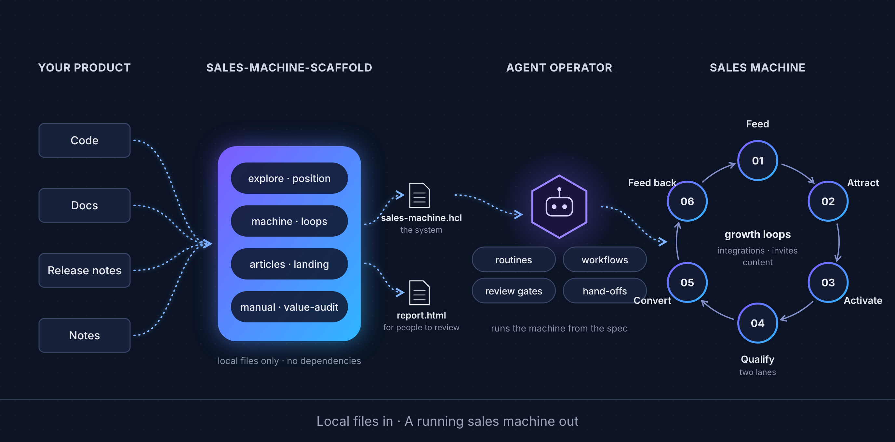

# sales-machine-scaffold

A skill for your AI agent that turns what your product already does into a complete plan to sell
it: who it is for, what to say, which articles and pages to publish, how people go from "never
heard of it" to "customer", and a manual for your team.

<p align="center">
  
</p>

## What it is for

You have a product, but the story around it is scattered: features nobody knows about, a home
page that lists features instead of results, no steady flow of articles, and a sales team with
no shared script. This skill reads your product's files (code, docs, release notes, notes) and
writes all of that for you, in one go.

Two things make it different from asking an AI to "write marketing copy":

- **It only says what is true.** Every claim it writes points back to a file in your product.
  Anything it cannot confirm is marked `[to confirm]` for you to answer, never made up.
- **It builds a machine, not a one-off campaign.** People find you through content, try the
  product without risk, show a buying signal, and each group of customers brings the next one.
  The skill designs each of those steps and writes the instructions an agent needs to keep it
  running every day.

It is useful for founders, product people and small teams who sell a B2B (or B2B2C) product and
do not have a marketing team yet, or who want their marketing to stay in sync with the product.

## How to install

You need an AI coding agent that supports skills, such as Claude Code.

1. Copy this folder into your agent's skills folder, for example
   `.claude/skills/sales-machine-scaffold/`.
2. Open your agent in the project that holds your product's files.

That's it. The skill needs no account, internet access, package or build step. It reads only
the files you point it to and writes plain files into a `sales-machine/` folder.

## How to run it

**1. Start with setup.** Type:

```
/sales-machine-scaffold setup
```

The agent reads your README and docs, fills in what it can, and then asks you **one** message
of questions about what it could not find: how people get access (open, invite-only, waitlist),
the main call to action, your most important type of customer, words you never want to use,
sensitive topics, and anything that must stay internal. Answer what you know; leave the rest
and it will be marked `[to confirm]`.

**2. Run the rest.** Ask the agent to run the full sequence, or run the steps one by one in this
order:

```
explore → position → machine → loops → article-ideas → landing → manual → value-audit → system-spec → report
```

Each step is `/sales-machine-scaffold <step>`. You can re-run any step later, for example after
a release or when you answer a `[to confirm]` item.

## What you get

Everything lands in a `sales-machine/` folder in your project. The main files:

| You get | What it is |
|---|---|
| **The report** (`report/sales-machine-report.html`) | One page that sums up everything: the machine, the diagrams, what is covered, what is missing, the problems found, and the list of questions still open. Opens in any browser, offline. **Start here.** |
| **Positioning** (`positioning.md`) | Who your main customer is, the one-line promise, what to say to each type of customer, and the words to use and avoid. |
| **The machine** (`machine.md`, `loops.md`) | The six stages people go through, from finding you to bringing others, what signals they are ready to buy, and the loops that make growth compound. |
| **Articles** (`articles/`) | Ready-to-edit articles, each written for one type of reader with one clear next step. |
| **Page specs** (`landing/`) | What your home page, persona pages and integration pages should say, line by line. |
| **Team manual** (`manual/`) | A brand and sales manual and a training ebook outline, with no technical jargon. |
| **Copy check** (`audit/findings.json`) | Problems found in existing text (yours or the skill's), each quoted with the fix. |
| **The machine for an agent** (`system/`) | A file that describes the finished machine so an AI agent can run it day to day: what to do, when, and where to stop for a human review. |

## How to use the output

1. **Open the report first** and read it top to bottom. It is written for people, not agents.
2. **Answer the open questions** at the end of the report (everything marked `[to confirm]`),
   then re-run the steps it names. The old versions are kept in `history/`.
3. **Fix your current pages** using the copy check: each finding quotes the problem and gives
   the replacement text.
4. **Publish.** Review the articles and page specs, adjust the tone, and publish them on your
   site, blog or docs. Nothing is published for you.
5. **Share the manual** with whoever talks to customers, so everyone tells the same story.
6. **Keep it running.** Load `system/operator.md` and `system/sales-machine.hcl` into an agent
   workspace. The agent then writes the next batch of articles on schedule, checks every text
   before it goes out, and hands results to your team for review. To change how the machine
   works, change the spec first (`/sales-machine-scaffold system-spec`).

## See a real example

[`examples/workflow-blueprint.com`](examples/workflow-blueprint.com/) is a full run on an open
source product: the files it read, every file it wrote, and the final report. Download
[`sales-machine-report.html`](examples/workflow-blueprint.com/sales-machine/report/sales-machine-report.html)
and open it in your browser to see what you will get (GitHub shows HTML files as code).

## Technical docs

For how it works under the hood:

- [Setup and config](docs/setup-and-config.md): what `setup` asks, every field of `config.json`,
  the folders it creates.
- [Commands](docs/commands.md): every command, the files each one writes, and the repository layout.
- [The HCL system spec](docs/system-spec.md): the format of the agent-run machine and how it is checked.
- [Frameworks](docs/frameworks.md): the sales and growth frameworks the rules come from
  (product-led growth, B2B Elements of Value, growth loops, jobs to be done, fact ledger).
- [`SKILL.md`](SKILL.md): the skill itself, the source of truth for how it behaves.
